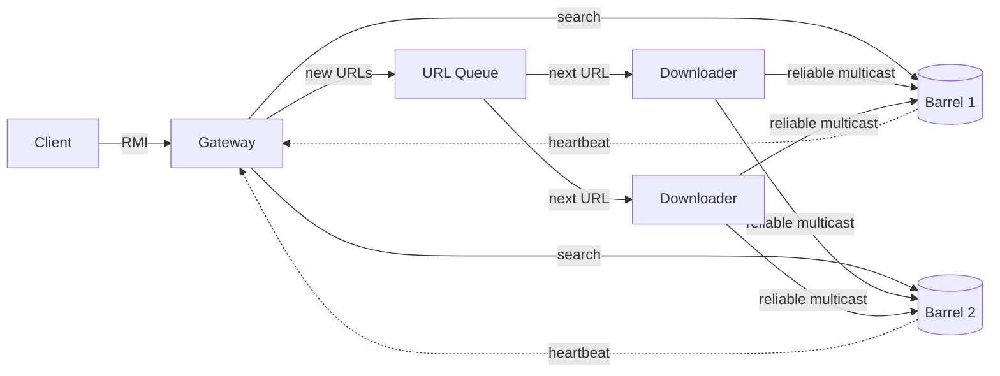

# Googol: Distributed Search Engine

> 🇵🇹 [Versão em português](README.pt.md)

A distributed web search engine written in **Java RMI**, built for the Distributed Systems course (2026/27, Milestone 1) at the University of Coimbra.

Googol automatically crawls and indexes web pages, starting from seed URLs and from URLs submitted by users. Users can search for pages containing a set of words; results are ranked by number of incoming links and shown 10 at a time.

## ✨ Highlights
- **5 independent programs** that can run on different machines
- **Parallel crawling** with multiple Downloaders (jsoup)
- **Replicated, persistent inverted index**, kept consistent through **reliable multicast** with retransmission
- **Fault tolerance:** heartbeats, automatic Barrel removal and re-sync, URLs returned to the queue if a Downloader dies, client retries
- **Real-time statistics** pushed to clients via RMI callbacks
- Fully configurable through a properties file (no recompilation needed)

## 🏗️ Architecture



| Program | Class | Role |
|---|---|---|
| URL Queue | `queue.URLQueue` | Stores URLs to visit and hands each one to a single Downloader |
| Downloader | `downloader.Downloader` | Downloads and parses pages (jsoup) and sends them to the Barrels via reliable multicast. Several can run in parallel |
| Storage Barrel | `barrel.Barrel` | Stores the replicated, persistent inverted index and answers searches |
| Gateway | `gateway.Gateway` | Single entry point for clients. Distributes searches across Barrels and pushes real-time statistics |
| Client | `client.Client` | Console menu to index URLs, search, view backlinks and statistics |

## 📋 Requirements
- **JDK 17+** (`java` and `javac` on the PATH; check with `java -version`)
- **jsoup** is already bundled at `lib/jsoup-1.23.2.jar`

## 📁 Project structure
```
googol.properties   configuration, read at startup
lib/                jsoup-1.23.2.jar
src/common/         shared classes (config, messages, text/URL normalization)
src/queue/          URL Queue
src/downloader/     Downloader + reliable multicast
src/barrel/         Storage Barrel
src/gateway/        Gateway
src/client/         Client
```

## 🔨 Build
Run from the project root.

**Linux / macOS**
```bash
javac -encoding UTF-8 -d out -cp lib/jsoup-1.23.2.jar $(find src -name "*.java")
```

**Windows (PowerShell)**
```powershell
javac -encoding UTF-8 -d out -cp lib\jsoup-1.23.2.jar (Get-ChildItem src -Recurse -Filter *.java).FullName
```

## ▶️ Run on a single machine
The bundled `googol.properties` works out of the box. Start each program in its own terminal from the project root.
Recommended order (programs also tolerate other orders and wait for missing ones):

**Linux / macOS**
```bash
java -cp "out:lib/jsoup-1.23.2.jar" gateway.Gateway
java -cp "out:lib/jsoup-1.23.2.jar" barrel.Barrel Barrel1
java -cp "out:lib/jsoup-1.23.2.jar" barrel.Barrel Barrel2
java -cp "out:lib/jsoup-1.23.2.jar" queue.URLQueue
java -cp "out:lib/jsoup-1.23.2.jar" downloader.Downloader
java -cp "out:lib/jsoup-1.23.2.jar" downloader.Downloader
java -cp "out:lib/jsoup-1.23.2.jar" client.Client
```
On Windows, use `;` as the classpath separator: `-cp "out;lib\jsoup-1.23.2.jar"`.

Notes:
- The **Barrel name is required** and identifies its data file. Two Barrels must never share a name.
- You can run several Downloaders and several Clients.
- Every program accepts an optional last argument: the path to another configuration file (default: `googol.properties` in the current folder).
- Stop any program with `Ctrl+C`.

## 🌐 Run on two machines
Copy the compiled project to both machines and adjust each `googol.properties`:

| Setting | Machine #1 | Machine #2 |
|---|---|---|
| Programs | Gateway, URLQueue, Barrel, Downloader | Barrel, Downloader, Client |
| `rmi.host` (where the queue runs) | IP of #1 | IP of #1 |
| `gateway.host` (where the Gateway runs) | IP of #1 | IP of #1 |
| `rmi.hostname.local` (IP of **this** machine) | IP of #1 | IP of #2 |

- Give the Barrels different names (e.g. `Barrel1` on #1, `Barrel2` on #2).
- Both machines must be on the same network and the firewall must allow `java`. RMI uses the registry ports (`rmi.port`, `gateway.port`) plus dynamic ports for remote objects.

## 💻 Using the client

| Option | Action |
|---|---|
| `1` | Index a URL (added to the front of the queue) |
| `2` | Search. Results shown 10 at a time: `s` next, `a` previous, `l N` pages linking to result N, `m` back to menu |
| `3` | Show pages that link to a given URL |
| `4` | Real-time statistics (refreshed only on change). Press Enter to return |
| `0` | Exit |

## ⚙️ Configuration (`googol.properties`)

| Key | Meaning |
|---|---|
| `rmi.host`, `rmi.port` | Host and port of the URL Queue's RMI registry |
| `rmi.hostname.local` | This machine's IP, advertised in remote references (needed for cross-machine callbacks) |
| `rmi.timeout.ms` | Max time to connect to another machine and wait for a remote call |
| `queue.name` | Queue name in the registry |
| `queue.seeds` | Comma-separated seed URLs |
| `queue.max.retries` | Retries for a URL that failed with a temporary error |
| `queue.downloader.check.ms` | Ping interval for Downloaders working on a URL; if one dies, the URL goes back to the queue |
| `queue.data.file` | File where the queue saves pending URLs, seen URLs and retry counts |
| `queue.save.interval.ms` | Interval between queue state saves |
| `gateway.host`, `gateway.port`, `gateway.name` | Gateway host, registry port and name |
| `gateway.barrel.timeout.ms` | Time without a heartbeat before the Gateway drops a Barrel |
| `gateway.queue.retry.ms` | Interval to resend URLs requested while the queue was down |
| `gateway.data.file` | File where the Gateway saves pending URLs and search counts |
| `gateway.save.interval.ms` | Interval between search count saves |
| `downloader.delay.ms` | Pause between pages for each Downloader |
| `downloader.reconnect.ms` | Interval to re-check the queue and the Barrel list |
| `multicast.retry.ms` | Retransmission interval to a Barrel that did not acknowledge |
| `barrel.data.dir` | Folder where Barrels store their index |
| `barrel.save.interval.ms` | Interval between index saves |
| `barrel.heartbeat.ms` | Interval between each Barrel's heartbeat to the Gateway |
| `client.retry.ms` | Interval between client retries when the Gateway does not respond |
| `client.retry.attempts` | Attempts per request before the client gives up and returns to the menu |

Configuration errors (missing file, invalid value, port in use) print a single `Error: ...` line and the program exits.

## 🧹 Resetting test data
- Each Barrel stores its index in `data/<name>.ser`
- The Gateway stores its state in `data/gateway-state.ser`
- The URL Queue stores its state in `data/queue-state.ser`

To start fresh, stop the Gateway, the Queue and **all** Barrels, then delete the `data/` folder on **all** machines. A starting Barrel copies its index from any active Barrel, so if one is still running the old data will come back.

## 👤 Author
**Diogo Silva**, Computer Engineering @ University of Coimbra
